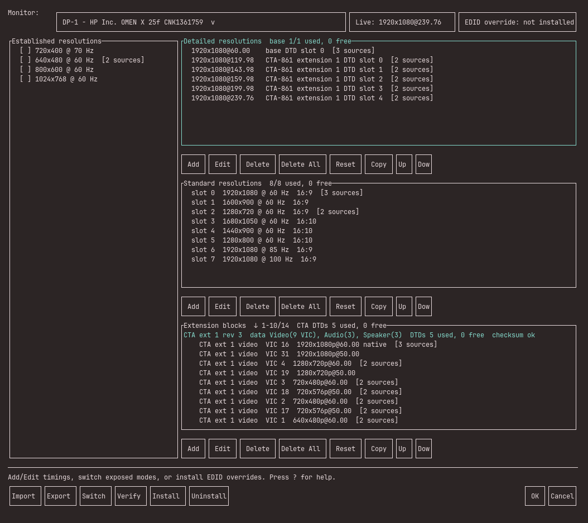

# drmcru

`drmcru` is a Linux DRM/KMS custom resolution utility.

It edits monitor EDID data, exports patched EDID binaries, and can install those
overrides on supported systems so the kernel exposes custom modes after reboot.
Hyprland integration is included for live mode discovery, switching, verification,
and generated legacy `monitor=...` or Hyprland 0.55+ Lua monitor rules.

> `drmcru` is an early preview. EDID overrides affect display initialization;
> keep a known-good mode or another way to access the system available.

[](assets/drmcru.png)

## Status

This release has been tested on:

- Hyprland 0.56.0 with NVIDIA DRM
- external DisplayPort and internal eDP discovery
- Limine with `limine-mkinitcpio`

Exported EDIDs can be installed manually on other setups. Automatic
Install/Update/Uninstall requires Limine entry-tool with its `limine-mkinitcpio`
integration and a boot partition mounted at `/boot`.

## Install

On Arch Linux, install [`drmcru-bin`](https://aur.archlinux.org/packages/drmcru-bin)
from the AUR using an AUR helper of your choice, for example:

```sh
yay -S drmcru-bin
```

Download the portable x86-64 binary from the
[latest release](https://github.com/ssupt/drmcru/releases/tag/v0.1.6):

```sh
curl -LO https://github.com/ssupt/drmcru/releases/download/v0.1.6/drmcru-0.1.6-x86_64-unknown-linux-musl
curl -LO https://github.com/ssupt/drmcru/releases/download/v0.1.6/SHA256SUMS
sha256sum -c --ignore-missing SHA256SUMS
chmod +x drmcru-0.1.6-x86_64-unknown-linux-musl
./drmcru-0.1.6-x86_64-unknown-linux-musl doctor
./drmcru-0.1.6-x86_64-unknown-linux-musl
```

The TUI and manual Export work on Linux systems that expose connectors through
`/sys/class/drm`. Hyprland is optional, but `hyprctl` is required for live mode
discovery, switching, and verification.

Automatic Install/Update/Uninstall requires `pkexec`, Limine entry-tool,
`limine-mkinitcpio`, mkinitcpio, and binutils (`objcopy`). Custom preset-only
systems can use Export.

Run `drmcru` as your normal desktop user, not with `sudo`. It requests only the
privileged Apply/Uninstall step through `pkexec`; running the whole TUI as root
can hide the active Hyprland session and create root-owned exports.

## Build From Source

Rust 1.88 or newer is required.

```sh
git clone https://github.com/ssupt/drmcru.git
cd drmcru
cargo build --release
./target/release/drmcru doctor
./target/release/drmcru
```

Useful commands:

```sh
cargo run
cargo run -- demo
cargo run -- doctor
cargo run -- --help
cargo run -- --version
```

Run `drmcru demo` to explore the interface using synthetic display data without
reading or changing a real monitor.

## Basic Workflow

1. Select a monitor.
2. Add, edit, copy, or paste a Detailed Resolution.
3. Export the patched EDID, or Install/Update it on a supported system.
4. Reboot.
5. Run `drmcru doctor`.
6. If Hyprland exposes the mode, use Switch or persist the generated
   `monitor=...` rule in your Hyprland config.

`Switch` only selects modes already exposed by DRM/Hyprland. It does not make a
new EDID mode appear.

Export writes the current working EDID. With no pending changes, it asks you to
make an edit before writing any files. VRR edits and stereo cleanup also count
as pending changes.

## What It Can Edit

- Established timing inspection
- Base-block detailed timing descriptors
- Base-block standard timings
- CTA-861 extension detailed timing descriptors
- EDID 1.4 range-limits-only VRR descriptors (minimum and maximum refresh)

Choose **VRR range** or press `Shift+R` to edit an existing advertised range.
For example, change `24–120 Hz` to `40–120 Hz` when the monitor cannot operate
reliably below 40 Hz. Export or Install/Update the override and reboot to apply.
The editor preserves horizontal limits and other descriptor data and supports
whole Hz from 1 to 510. It requires a continuous-frequency EDID with an existing
range-limits-only descriptor, as used by Linux DRM for DisplayPort VRR. HDMI
FreeSync/Forum and DisplayID VRR blocks are currently read-only; the editor
does not add VRR support to a monitor that does not advertise it.

Export and Install/Update clear stereo flags from all base and CTA detailed
resolutions and repair the affected checksums. This also works when clearing
stereo flags is the only pending change. Sync polarity, interlace, physical
dimensions, and unrelated descriptors and extension data are preserved.

DisplayID Type I detailed timings are decoded and can be copied into an
editable EDID DTD. DisplayID blocks themselves are currently read-only.

Detailed timings are the right place for custom modes such as `1280x1080@240`.
EDID standard timings have fixed aspect-ratio limits and are not suitable for
arbitrary shapes.

## Apply Model

Wayland compositors do not work like X11 modeline injection. For reliable custom
modes, the kernel must see the mode in the connector EDID.

`drmcru` writes EDID overrides for use with:

```text
drm.edid_firmware=DP-1:edid/drmcru_custom_DP-1.bin
```

On the supported Limine/mkinitcpio path, Install/Update modifies:

- `/lib/firmware/edid/<name>.bin`
- `/etc/mkinitcpio.conf.d/20-drmcru.conf`
- `/boot/limine.conf`
- `/etc/limine-entry-tool.d/drmcru-edid.conf` (managed mapping state)
- `/etc/default/limine` (a marked block of effective kernel command lines)
- `/boot/drmcru-recovery` (the previous boot entry's kernel and images)

It backs up configuration, firmware and the entire boot partition before making
changes. Every installed kernel and configured or existing fallback image is
built in a private staging directory. Before updating boot entries, drmcru checks
the embedded firmware and UKI command lines. Failures restore the tracked
configuration, firmware and boot partition, including partially replaced images.
Configuration and firmware also have timestamped `.drmcru.*.bak` backups.

Existing root, encryption and per-kernel arguments are preserved. Overrides from
other Limine files are consolidated into one EDID parameter per command line.
The managed block follows user settings in `/etc/default/limine` so later appends
cannot undo that consolidation. Update refreshes it after changes to the
underlying command-line sources; Uninstall removes it when no longer needed.
Connector mappings that would also match another connector are rejected.

The mkinitcpio drop-in appends EDID paths with `FILES+=(...)`, preserving existing
files and overrides for other monitors. Install/Update migrates this monitor's
legacy entry from `/etc/mkinitcpio.conf` when present. Uninstall removes its entry
and deletes the drmcru drop-in when no overrides remain.

Automatic Apply uses mkinitcpio's default configuration and drop-ins, building
each image directly rather than relying on the rebuild wrapper's exit status.
Custom UKI options that can override the verified output or command line are
rejected. Export includes instructions for configuring other systems manually.

## Recovery

If a custom mode is unusable but the desktop remains accessible, switch back
to a known-good mode, choose Uninstall in `drmcru`, and reboot.

The Limine menu retains a **drmcru recovery (before last change)** entry with
copies of the previous kernel and images. Select it if the new override prevents
normal startup. It represents the state before the most recent successful Apply
or Uninstall, rather than a guaranteed known-good configuration.

If the graphical session is unusable, you can also boot once without the
`drm.edid_firmware=...` parameter using the Limine entry editor or another boot
entry. Then run `drmcru`, choose Uninstall, and reboot. Changed configuration
files have timestamped backups beside the originals, including the main
`mkinitcpio.conf` when migrating a legacy installation.

If a failure reports incomplete recovery, keep the reported recovery directory
and repair the boot partition before rebooting. Automatic installation requires
space for staged images, a complete boot backup and the retained recovery entry.

## First-run troubleshooting

- Run `drmcru doctor` first and include its output when reporting a problem. It
  reports the drmcru and Hyprland versions, detected connectors, EDID state, and
  whether automatic Apply is supported.
- A newly added mode will not appear in Hyprland until the kernel boots with the
  EDID override. Install or manually configure the override, reboot, then Verify.
- Automatic Apply intentionally stops on unsupported bootloader/initramfs setups.
  Export still produces the EDID plus distribution-neutral manual instructions.
- Run the TUI in an interactive terminal (80×24 or larger is recommended). For
  scripts, redirected output, or support logs, use `drmcru doctor` instead.
- If `pkexec` is installed but no authentication prompt appears, make sure a
  polkit authentication agent is running in the desktop session.
- Internal eDP panels often cannot scale arbitrary smaller scanouts. Prefer the
  panel's native active resolution and change only its refresh timing.
- Use `drmcru demo` to check terminal rendering and controls without reading or
  modifying real monitor data.

## Hyprland

When `hyprctl` is available, `drmcru` can:

- merge DRM connector data with `hyprctl monitors -j`
- list Hyprland's exposed modes
- switch to an already exposed mode
- verify the active mode
- inspect simple legacy `monitor=` rules and sourced config files
- inspect literal Hyprland 0.55+ `hl.monitor({...})` calls
- follow literal local `dofile(...)` and `require("hypr.monitors")`-style modules

Generated persistent rules follow the detected config format: `hyprland.lua`
takes precedence when present, otherwise `hyprland.conf` syntax is used. Runtime
switching first tries the legacy keyword command and falls back to a Lua
`hl.monitor({...})` evaluation on Hyprland 0.55 and newer.

Dynamic Lua expressions are not executed during config inspection. This keeps
diagnostics read-only; literal user monitor modules are followed in load order.

`drmcru` does not auto-edit Hyprland config.

## Feedback

Use the repository's bug or hardware-report issue templates when testing a new
GPU, monitor, connector, bootloader, or initramfs stack. `drmcru doctor` output
is the most useful starting point.

## License

GPL-3.0-or-later. See [LICENSE](LICENSE).
